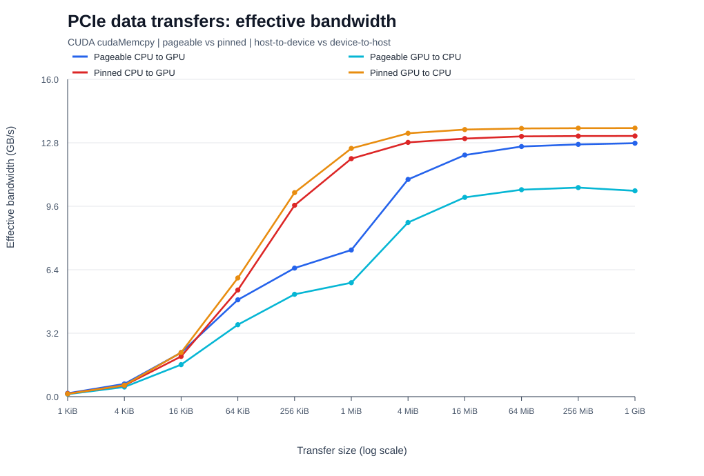

# GPU Computing - Exercise 2

Heidelberg University - Winter Term 2026/2027

**Group:** [TO COMPLETE]  
**Authors:** [TO COMPLETE]

**Submission status.** This report proposal includes the available synchronous measurements for Exercise 2.1 and the existing results for Exercise 2.3. The asynchronous sweep and baseline comparison for Exercise 2.1, and the numerical result for Exercise 2.2, remain to be supplied. Section 2.4 is pending the group's decision.

## 2.1 Raw Kernel Startup Time

### Objective and methodology

We investigate the cost of launching an empty CUDA kernel and the influence of launch configuration. The baseline program implements two timing modes. In the asynchronous mode, it issues a batch of kernel launches and calls cudaDeviceSynchronize() once at the end. In the synchronous mode, it synchronizes after every kernel launch. Both elapsed host times are divided by the number of launches.

The asynchronous result represents the average time per completed launch in a batch; the synchronous result additionally includes the per-launch wait for completion. Neither quantity isolates the execution time of the empty kernel on the GPU. For the same launch configuration, any difference between the modes must be interpreted in terms of submission, execution and synchronization overheads.

The configuration sweep uses 15 grid sizes, numBlocks = 2^i for i = 0,...,14, and 11 block sizes, threadsPerBlock = 2^j for j = 0,...,10. This gives 165 combinations and includes the required endpoints 1-16384 blocks and 1-1024 threads per block. Each available point measures one launch followed by cudaDeviceSynchronize(), using the host timer chTimer. The recorded values are in seconds and are converted to microseconds in the figure.

### Baseline comparison

| Quantity | Measured value |
|---|---|
| Mean asynchronous time, 1 block and 1 thread | [TO COMPLETE] us |
| Mean synchronous time, 1 block and 1 thread | [TO COMPLETE] us |
| GPU and execution environment for 2.1 | [TO COMPLETE] |

The source implements this comparison, but its numerical output is not included in the available files. The configuration sweep currently supplies synchronous measurements only. The corresponding asynchronous sweep and figure are required to complete this section; no asynchronous values are inferred from the synchronous data.

<!-- PAGEBREAK -->

## 2.1 Results and interpretation

Figure 1. Host-observed launch-plus-synchronization time for the empty kernel. The original heatmap uses a colour range of 7-20 us; values outside this interval are saturated. In particular, the first measurement and the largest configurations cannot be read quantitatively from colour alone.

| numBlocks | threadsPerBlock | Time (us) |
|---|---|---|
| 1 | 1 | 264207 |
| 1 | 2 | 8 |
| 1 | 1024 | 7 |
| 1024 | 1024 | 10 |
| 4096 | 1024 | 21 |
| 8192 | 1024 | 35 |
| 16384 | 1 | 20 |
| 16384 | 1024 | 63 |

The first point takes 0.264207 s. It is not representative of steady-state startup cost: it is measured before any explicit CUDA warm-up and is consistent with one-time runtime/context initialization. This explanation is an interpretation of the measurement order, rather than an independently measured decomposition of initialization costs.

Excluding the first point, the recorded times range from 7 to 63 us, with a median of 7 us. Small and moderate grids are mostly close to this lower range. For large grids, time rises, particularly with 512 or 1024 threads per block. At 1024 threads per block, increasing the grid from 1024 to 16384 blocks raises the measured time from 10 to 63 us. This is consistent with additional block scheduling and completion work, even though the kernel body is empty.

Each configuration was sampled once, so isolated changes cannot establish a reproducible performance effect. The output format stores seconds to six decimal places, corresponding to 1-us granularity in the saved data. These results characterize synchronous launch and completion; they do not establish the configuration dependence of asynchronous launch throughput.

<!-- PAGEBREAK -->

## 2.2 Break-even Kernel Startup Time

### Objective and implemented experiment

The objective is to find how many GPU clock cycles a kernel must wait before the measured average asynchronous launch time doubles relative to the zero-wait baseline. The requested search accuracy is within 100 clock cycles [1].

The kernel records clock() on entry and repeatedly checks the elapsed cycle count until it reaches the requested duration. The host launches it with one block and one thread. It first warms up CUDA with ten zero-wait launches and a final synchronization, then measures ten zero-wait launches followed by one synchronization. The baseline is the batch duration divided by ten.

Let T0 be this baseline. The program tests waiting times c = 100, 200, 300,... cycles. For each c, it times another batch of ten launches and divides by ten to obtain T(c). The reported candidate is the first tested c for which T(c) >= 2*T0. The timed quantity includes the final synchronization amortized over the batch.

### Results to be supplied

| Quantity | Measured value |
|---|---|
| GPU and execution environment | [TO COMPLETE] |
| Baseline T0 | [TO COMPLETE] us |
| Doubling threshold 2*T0 | [TO COMPLETE] us |
| Last tested duration below threshold, c_previous | [TO COMPLETE] cycles |
| Mean time T(c_previous) | [TO COMPLETE] us |
| First tested duration reaching threshold, c_break-even | [TO COMPLETE] cycles |
| Mean time T(c_break-even) | [TO COMPLETE] us |

No experimental result for this exercise has been supplied yet, so a numerical break-even value cannot be reported. The final interpretation must identify the first threshold crossing and distinguish the 100-cycle search increment from the uncertainty caused by timing variation. The previous point documents the crossing; the assignment does not explicitly require a graph for this exercise.

### Implementation status

The current source implements the clock-based wait and threshold search. The assignment also explicitly requests a parameter-controlled write of the elapsed clock difference to a device variable to guard against compiler optimization. This write is absent from the current source. The locally generated optimized PTX still contains the wait loop, but this does not replace the requested source-level safeguard. The section must not claim that this requirement has already been implemented.

## 2.4 Willingness to present

Declaration pending the group's decision.

<!-- PAGEBREAK -->

## 2.3 PCIe Data Movements

### Objective and experimental setup

This experiment compares effective CPU-GPU transfer bandwidth using cudaMemcpy(), pageable host memory allocated with malloc(), and pinned host memory allocated with cudaMallocHost(). Both host-to-device (H2D) and device-to-host (D2H) transfers are measured over 11 sizes from 1 KiB to 1 GiB.

| Parameter | Configuration |
|---|---|
| Cluster / compute node | HAWAII / csg-brook02 |
| GPU | NVIDIA GeForce RTX 2080 Ti; 11264 MiB |
| Job | Slurm 279166; exercise-gpu; 1 GPU, 2 CPUs, 8 GiB RAM |
| Compilation, as recorded in the existing report | CUDA 12.8.0; nvcc -O2 -std=c++14 -arch=sm_75 |
| Job time limit | 00:20:00; reservation limit, not measured runtime |
| Results used | raw/es2.3/pcie_output.txt |
| Matching original graph | raw/pcie_graph.svg |

Compiler settings are retained from the existing Exercise 2.3 report; the available job log independently identifies the node, GPU and job, but does not print the compiler version. The second available job, 279170, is a separate execution and is not mixed into the following table or figure.

### Measurement methodology

One 1-GiB pageable host buffer, one 1-GiB pinned host buffer and one device buffer are allocated and initialized before timing. Allocation and initialization costs are excluded. The transfer sizes are S = 1 KiB * 4^k, k = 0,...,10. Every size is measured in all four combinations of memory type and direction, yielding 44 results.

Each condition performs three warm-up copies and a synchronization. The benchmark then times a batch of repeated cudaMemcpy() calls using std::chrono::steady_clock, synchronizes again, and divides the batch time by the number of repetitions. It uses 1000 repetitions up to 64 KiB, 200 up to 1 MiB, 30 up to 16 MiB, 8 up to 256 MiB, and 4 at 1 GiB.

Effective bandwidth is calculated as S / (T_average * 10^9) GB/s, with S in bytes and T_average in seconds. Bandwidth uses decimal GB/s; transfer sizes use binary KiB, MiB and GiB. Timing includes API, copying and synchronization overheads and therefore measures application-observed effective bandwidth. In particular, the final synchronization also covers any pageable H2D device transfer that has not completed when the API call returns [3].

<!-- PAGEBREAK -->

## 2.3 Results

Figure 2. Original bandwidth graph matching job 279166. The size axis is logarithmic. Four curves compare pageable and pinned host memory in both transfer directions.

| Size | Pageable H2D | Pageable D2H | Pinned H2D | Pinned D2H |
|---|---|---|---|---|
| 1 KiB | 0.1718 | 0.1266 | 0.1486 | 0.1429 |
| 4 KiB | 0.6431 | 0.486 | 0.567 | 0.5789 |
| 16 KiB | 2.218 | 1.612 | 2.028 | 2.227 |
| 64 KiB | 4.883 | 3.629 | 5.377 | 5.986 |
| 256 KiB | 6.485 | 5.16 | 9.648 | 10.29 |
| 1 MiB | 7.394 | 5.746 | 12 | 12.52 |
| 4 MiB | 10.95 | 8.781 | 12.82 | 13.28 |
| 16 MiB | 12.18 | 10.05 | 13.01 | 13.47 |
| 64 MiB | 12.61 | 10.43 | 13.12 | 13.52 |
| 256 MiB | 12.72 | 10.54 | 13.14 | 13.54 |
| 1 GiB | 12.78 | 10.38 | 13.15 | 13.54 |

Table 2. Measured effective bandwidth in GB/s, as printed in the job 279166 log. Values retain the precision available in that log. The original CSV is referenced by the existing report but is not present in the supplied directory.

<!-- PAGEBREAK -->

## 2.3 Discussion and interpretation

**Transfer size.** At 1 KiB, throughput is approximately 0.13-0.17 GB/s, compared with 10.38-13.54 GB/s at 1 GiB. Fixed invocation and transfer-setup costs dominate small messages. As the transfer grows, those costs are amortized and the curves approach a plateau. This is consistent with the motivation for batching small transfers when practical [2].

**Pageable versus pinned memory.** Pinned memory generally achieves higher bandwidth. At 1 GiB, pinned H2D reaches 13.15 GB/s versus 12.78 GB/s for pageable H2D, an improvement of about 2.9%. Pinned D2H reaches 13.54 GB/s versus 10.38 GB/s, about 30.4% higher. Pinned buffers enable direct DMA transfers; pageable transfers can involve additional staging [2,3].

**Direction and small transfers.** The directions are not perfectly symmetric: pageable H2D outperforms pageable D2H at 1 GiB, while pinned D2H slightly outperforms pinned H2D. Pinned H2D is slower than pageable H2D at 1, 4 and 16 KiB. For small messages, fixed overheads and timing variation can outweigh the benefits of pinned memory.

**PCIe reference.** The assignment gives approximately 15.8 GB/s as the theoretical PCIe 3.0 x16 bandwidth [1]. The maximum measured value, 13.54 GB/s for pinned D2H, is about 85.7% of that reference. The gap is consistent with effective transfers including overheads. Link generation and width were not independently checked, so 15.8 GB/s is a comparison baseline rather than a measured hardware property.

### Limitations and conclusion

The table and figure use a single selected benchmark execution. Repeated transfers are averaged within each condition, but no confidence intervals or independent-run variability are reported. The host timer measures completed batches of copy calls, rather than isolated bus occupancy. CPU activity, cache effects and runtime behaviour may affect effective bandwidth. Host allocation cost is intentionally excluded.

The required 11 sizes and four transfer conditions were measured. Bandwidth grows with message size and saturates for large transfers. Pinned memory provides the strongest large-transfer result, 13.54 GB/s, while its advantage is small or reversed for some tiny H2D transfers. These conclusions preserve the scope and interpretation of the existing Exercise 2.3 report.

### References

[1] H. Froning et al., GPU Computing - Architecture and Programming, Exercise 2, Winter Term 2026/2027. Heidelberg University course handout, Sections 2.1-2.4.

[2] NVIDIA, CUDA C++ Best Practices Guide, Data Transfer Between Host and Device / Pinned Memory. https://docs.nvidia.com/cuda/cuda-c-best-practices-guide/index.html#pinned-memory

[3] NVIDIA, CUDA Runtime API, API Synchronization Behavior. https://docs.nvidia.com/cuda/cuda-runtime-api/api-sync-behavior.html
